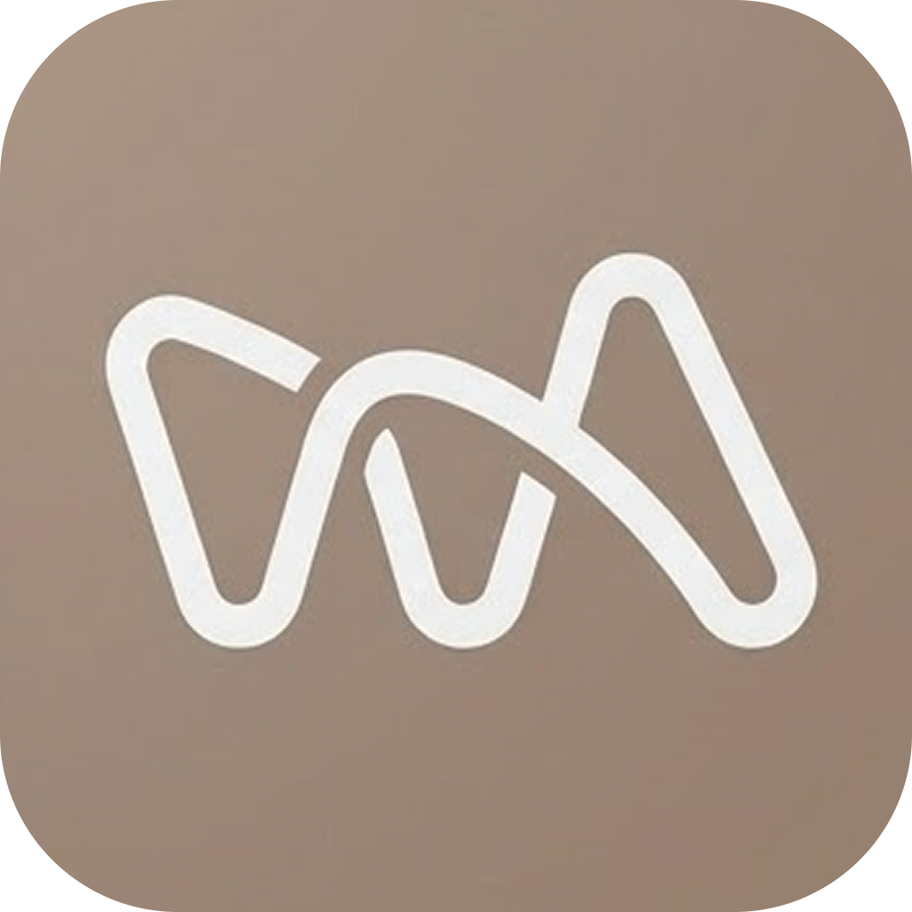

<p align="center">
  
</p>

<h1 align="center">WithArt · 위드아트</h1>

<p align="center">
  <strong>작가와 공간 운영자를 연결하는,<br />유휴 벽면 전시 공간 예약 서비스.</strong>
</p>

<p align="center">
  <a href="https://withart.vercel.app">🌐 웹 서비스</a> ·
  <a href="https://play.google.com/store/apps/details?id=com.withart.service&hl=ko">📱 Google Play</a>
</p>

## 1. 프로젝트 소개 📝

위드아트는 전시할 곳을 찾는 작가와 활용 가능한 벽면 공간을 가진 운영자를 연결하는 서비스입니다.
작가는 지도에서 공간을 찾고 작품과 전시 기간을 선택해 예약하며, 공간 운영자는 공간을 등록하고 예약을 관리합니다.

유휴 벽면을 전시 공간으로 연결하는 비즈니스 모델을 기획하고 특허를 출원했습니다.
서비스 기획과 기능·이용 흐름 설계부터 통신판매업 신고, 토스 결제 서비스 신청, 웹 배포와 앱 심사까지 직접 진행해 **웹과 Google Play 앱을 출시했습니다.**

초기 웹·앱과 기존 서비스 코드는 **AI를 활용해 제작했습니다.**
현재는 예약·결제 백엔드를 직접 개발하며, 기존 Next.js·Supabase 기반 처리를 NestJS 서버로 이전하고 있습니다.
이 저장소는 그 과정에서 구축 중인 백엔드 프로젝트입니다.

### 개발 기간 📅

| 구분 | 기간 |
| --- | --- |
| 🎨 전체 프로젝트 | 2025.09 ~ 진행 중 |
| ⚙️ NestJS 백엔드 구축 | 2026.10 ~ 진행 중 |

### 담당 범위 🧑‍💻

| 구분 | 내용 |
| --- | --- |
| 💡 기획·설계 | 비즈니스 모델 기획, 작가·공간 운영자의 기능과 이용 흐름 설계 |
| 📄 특허 | 유휴 벽면 전시 매칭·임대 중개 모델에 대한 특허 출원 |
| 📋 출시 준비 | 통신판매업 신고, 토스 결제 서비스 신청, 앱 심사 진행 |
| 🚀 서비스 출시 | 웹 배포와 Google Play 앱 출시 |
| 🤖 초기 코드 제작 | AI를 활용한 웹·앱 및 기존 예약·결제 기능 제작 |
| 🧑‍💻 현재 직접 개발 | 예약·결제 백엔드 구축과 기존 처리 로직의 NestJS 이전 |

---

## 2. 비즈니스 모델과 특허 출원 📄

작가에게는 작품을 전시할 공간을, 공간 운영자에게는 사용하지 않는 벽면을 전시에 활용할 수 있는 기회를 제공하는 모델입니다.
공간 탐색부터 작품 선택, 예약·결제, 운영자의 예약 관리까지 하나의 서비스로 연결했습니다.

| 항목 | 내용 |
| --- | --- |
| 💡 발명 명칭 | **유휴 벽면 공간 전시 매칭 및 임대 중개 시스템 및 그 방법** |
| 🔖 출원번호 | 제10-2025-0146968호 |
| 📄 상태 | 특허 출원 |

---

## 3. 출시 서비스와 주요 기능 ✨

| 구분 | 상태 | 링크 |
| --- | --- | --- |
| 🌐 웹 | ✅ 출시 완료 | [withart.vercel.app](https://withart.vercel.app) |
| 📱 Android 앱 | ✅ Google Play 출시 완료 | [Google Play에서 보기](https://play.google.com/store/apps/details?id=com.withart.service&hl=ko) |
| ⚙️ NestJS 백엔드 | 🚧 개발·이전 진행 중 | [wallspace-server](https://github.com/danpung12/wallspace-server) |

아래는 기존 출시 서비스의 기능입니다. 새 NestJS 서버로 이전을 완료한 기능 목록은 아닙니다.

| 기능 | 설명 |
| --- | --- |
| 🗺️ 지도 기반 공간 탐색 | 지역과 지도를 통해 전시 가능한 공간을 확인합니다. |
| 🖼️ 작품 선택·전시 예약 | 전시할 작품과 기간을 선택해 공간 이용을 신청합니다. |
| 💳 결제 | 토스페이먼츠를 통해 예약 결제를 진행합니다. |
| 🏠 공간 등록 | 공간 운영자가 전시에 사용할 공간을 등록합니다. |
| 📅 예약 관리 | 공간 운영자가 예약 신청을 확인하고 승인·거절합니다. |

---

## 4. 기술 스택 🛠️

### 기존 출시 서비스 · AI 활용 제작 🤖

#### Frontend 🖥️

[](https://nextjs.org/)
[](https://react.dev/)
[](https://www.typescriptlang.org/)
[](https://tailwindcss.com/)
[](https://zustand.docs.pmnd.rs/)
[](https://tanstack.com/query)

#### Mobile 📱

[](https://reactnative.dev/)
[](https://expo.dev/)
[](https://github.com/react-native-webview/react-native-webview)

앱은 React Native WebView로 웹 서비스를 연결하는 구조입니다.

#### Database · Payment · Deploy ☁️

[](https://supabase.com/)
[](https://docs.tosspayments.com/)
[](https://vercel.com/)

### 현재 직접 구축 중인 백엔드 🧑‍💻

#### Backend 🗄️

[](https://nestjs.com/)
[](https://www.typescriptlang.org/)
[](https://www.postgresql.org/)
[](https://www.prisma.io/)

Prisma는 `@prisma/orm-postgres` 기반으로 기존 DB 스키마와 연결을 구성하고 있습니다.

#### Test 🧪

[](https://jestjs.io/)
[](https://github.com/forwardemail/supertest)

---

## 5. 백엔드 개발 현황 🚧

현재는 **NestJS 서버와 DB 연결 기반을 구성한 초기 단계**입니다.
예약·결제 모듈의 기본 구조를 만들었으며, 실제 업무 로직과 기존 서비스 연동을 이어서 개발하고 있습니다.

| 작업 | 현재 상태 |
| --- | --- |
| ⚙️ NestJS 개발 환경 구성 | ✅ 구성 완료 |
| 🧩 예약·결제 모듈 분리 | 컨트롤러·서비스·모듈의 기본 구조 구성 |
| 🗃️ 기존 DB 스키마 반영 | Prisma 계약 파일과 타입 구성 |
| 🔌 DB 연결 관리 | 서버 시작 시 연결하고 종료 시 닫도록 생명주기 처리 작성 |
| 🛠️ 예약·결제 업무 로직 | 🚧 개발 예정 · 기존 기능을 분석하며 이전 진행 중 |
| 🔄 기존 웹·앱 연동 전환 | 📌 예정 |

### 다음 개발 범위 🎯

- 📅 서버에서 예약 기간, 공간 수용량, 사용자 권한을 검증합니다.
- 💳 서버에서 결제 금액과 주문 정보를 관리하고 토스 결제 승인·취소를 연동합니다.
- 🛡️ 결제 성공 후 예약 저장 실패, 중복 요청 등 예약과 결제 상태가 어긋나는 상황을 처리합니다.
- 🔄 기존 웹·앱의 예약·결제 요청을 NestJS API로 단계적으로 전환합니다.
- 🧪 핵심 예약·결제 흐름에 대한 테스트와 CI 검증을 추가합니다.

---

## 6. 출시 과정에서 다룬 문제 🔍

### Vercel 배포 후 토스 결제 오류 💳

로컬에서는 동작하던 결제가 Vercel 배포 후 결제창 진입과 인증 단계에서 실패했습니다.
연동 방식에 맞지 않는 API 키, 이전 환경변수 참조, 결제 인가된 상점과 사용한 키의 불일치를 확인했습니다.

연동 키와 환경변수 참조를 정리하고 인가된 상점의 키로 재배포한 뒤, 프로덕션에서 최종 결제 승인까지 확인했습니다.
기존 서비스 출시 과정에서 다룬 문제이며, 현재 NestJS 이전 작업과는 구분합니다.

- 📝 [토스 결제 오류 해결 기록](https://eunchong-ing.tistory.com/18)

---

## 7. 저장소 구조 📁

```text
wallspace-server/
├─ src/
│  ├─ booking/          # 예약 모듈 · 업무 로직 개발 예정
│  ├─ payment/          # 결제 모듈 · 업무 로직 개발 예정
│  ├─ prisma/           # 기존 DB 계약·타입과 DB 연결 관리
│  ├─ app.module.ts
│  └─ main.ts
├─ test/                # E2E 테스트 기본 구성
├─ docs/assets/         # README 이미지
├─ prisma.config.ts
└─ package.json
```

📝 개발 진행에 맞춰 구현 범위와 API, 검증 결과를 업데이트할 예정입니다.
